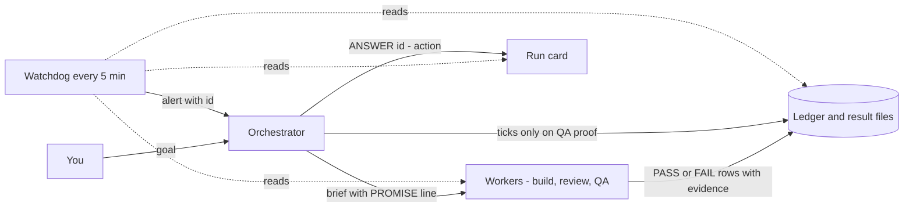
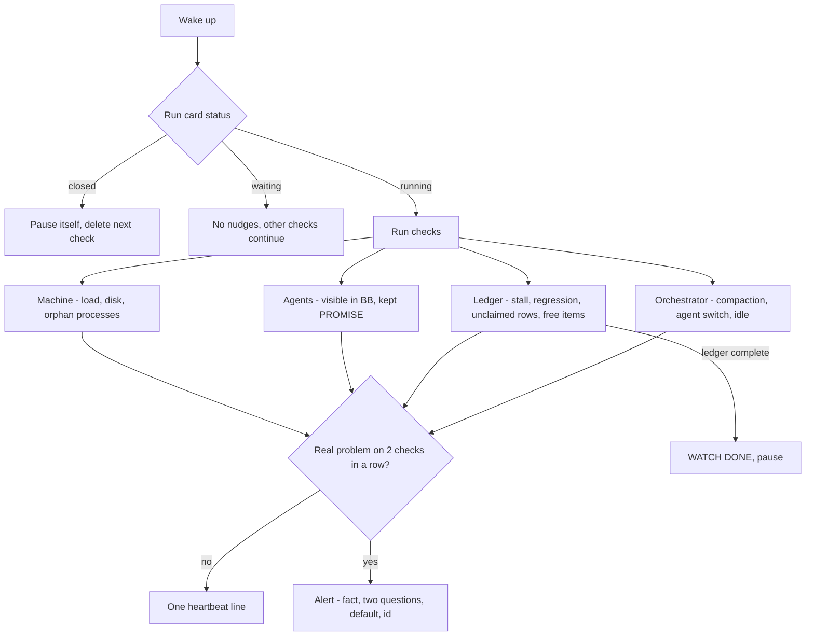
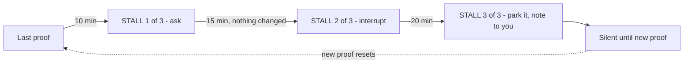

# Hivecall

Hand an agent a goal and let it run to the finish without you babysitting it.

## What it does

An orchestrator agent breaks your goal into a checklist, hands each piece to fresh worker agents, and ticks an item only when an independent tester proves it. A small watchdog script checks the run every 5 minutes. It nudges the orchestrator if it stalls, warns about stuck or hidden agents and machine problems, pauses when the ledger is complete, and removes itself after the run card is closed.

## When to use it

- A goal with many checkable pieces: a feature set, a spec, an ISA.
- You want it done end to end while you're away.

Not for: a quick fix, a one-file change, or research. It costs more than a normal session.

## How a run goes

1. You type `hivecall` and give a goal: a few sentences, a spec file, or an ISA.html.
2. For clear input, it shows a goal contract and plan; ambiguous input first gets a three-item Discovery ledger. It asks "Watchdog on?" and "Open a PR at the end?".
3. Clear-task runs wait for contract approval. On discovery, your two answers authorize the run and a reviewer approves or revises the plan.
4. It works through the checklist. Open `.hivecall/checklist.html` in a browser to see progress.
5. It ends in one of three ways:
   - **Done:** every item proven. You get a final report; the watchdog pauses first and removes itself on its next check after the run card is closed.
   - **Blocked:** it tells you what's in the way and what would unblock it.
   - **Stalled:** the watchdog pings you once and stops nudging.

Every reply ends with a one-row status table, so you can catch up at a glance.

## What's in this folder

| File | What it is |
|---|---|
| `SKILL.md` | The rules the orchestrator follows |
| `references/kickoff.md` | Goal contract, checklist, run card, how to end a run |
| `references/checklist-template.html` | The progress page |
| `watchdog/watch.py` | The watchdog script |
| `watchdog/lessons.md` | Rules learned from past runs |

## Needs

OpenCode v2 with the `orchestrator` agent and `python3`. The bundled plugin registers the skill, `/hivecall`, and deterministic hooks without a config entry. The watchdog's default integration uses the BB CLI; its rules and PROMISE parser stay separate from that adapter.

## Watchdog

A Python 3 script (built-ins only, no AI) that checks the run every 5 minutes: machine health, whether every agent is visible in BB and keeping its promise, whether the orchestrator went idle with work left, and whether the run is finished. The default BB adapter queues alerts and manages its automation; replace the `BB` adapter seam to use another harness. Its lifecycle actions are pausing its own timer when done and deleting itself on the check after the run card is closed. Its rules are the INVARIANTS block at the top of `watchdog/watch.py`; change them only with the owner's OK.

Each check takes 1–2 seconds of CPU. A failed read skips that check for the run; it never alarms on missing data. Simulator and recorder checks find nothing on projects that don't use them.

### Mental model

Who talks to whom. The watchdog only reads, then sends alerts.



What one 5-minute check does.



The no-progress ladder. Progress means a new PASS or FAIL, a new tick, or a new commit.



### Inputs

| Variable | Required | Value |
|---|---|---|
| `REPO` | yes | Absolute repo path (the orchestrator's worktree) |
| `ORCH_THREAD` | yes | Orchestrator BB thread id (`bb thread show --self --json`, or `bb thread search`) |
| `ORCH_SESSION` | yes | Orchestrator OpenCode session id: `REPO=... python3 watch.py --find-session` |
| `VERIFY_DIR` | yes | Folder where testers write result files, e.g. `$REPO/.hivecall/verification` |
| `LEDGER` | yes* | `.hivecall/checklist.html` or an ISA.html (*defaults to `_ai/docs/ISA.html`) |
| `RUN_CARD` | no | Defaults to `$REPO/.hivecall/run.md` |
| `PROJECT_ID` | yes for self-management | BB project id; used for delete and for the legacy pause lookup |
| `AUTOMATION_ID` | yes for automatic cleanup | Created automation id, used for pause and delete; if unset, pause falls back to the legacy name `hivecall watchdog <ORCH_THREAD>` and deletion is disabled |
| `STATE_FILE` | no | Defaults to `$REPO/.lanes/watch-state.json` |
| `LANE_ROOTS` | no | Extra folders (`:`-separated) a PROMISE `lane=` may live in. The repo and BB worktrees (`~/.bb/plugins/environment-git-worktree/host-data/worktrees`) are always allowed |

Optional limits: `WATCH_LOAD_LIMIT` (150), `WATCH_DISK_FREE_GB` (10), `WATCH_LARGE_FILE_MB` (100), `WATCH_LARGE_FILE_MIN` (15), `WATCH_AGENT_STUCK_MIN` (10), `WATCH_AGENT_MAX_HOURS` (3), `WATCH_GHOST_MIN` (15), `WATCH_ORPHAN_MIN` (15), `WATCH_CONTINUE_MIN` (15), `WATCH_STALL_MIN` (10; the ladder asks at this, +5 and +10 minutes), `WATCH_UNCLAIMED_GRACE_MIN` (5).

### Inspect

```sh
W="<path to this skill>/watchdog/watch.py"
export REPO="$(pwd)" LEDGER="$REPO/.hivecall/checklist.html" VERIFY_DIR="$REPO/.hivecall/verification"
export ORCH_THREAD='thr_...' ORCH_SESSION="$(python3 "$W" --find-session | head -1 | cut -f1)"
python3 "$W" --once-report   # read-only summary
python3 "$W" --dry-run       # prints messages instead of sending
```

### Turn it on

1. Copy `watch.py` into the repo at `.hivecall/watch.py` so the automation reads a file that does not move.
2. Create the automation (paused), capture its id, record the id in the run card, and update the automation with the id before resuming it:

```sh
LAUNCHER=$'import os, runpy, sys\np = os.path.join(os.environ["REPO"], ".hivecall/watch.py")\nsys.argv = [p] + sys.argv[1:]\nrunpy.run_path(p, run_name="__main__")'
ORCH_TITLE="$(bb thread show "$ORCH_THREAD" --json | python3 -c 'import json,sys; d=json.load(sys.stdin); print(d.get("title") or (d.get("thread") or {}).get("title", ""))')"
CREATE_ENV_JSON="$(python3 -c 'import json,os; keys=("ORCH_THREAD","ORCH_SESSION","REPO","LEDGER","VERIFY_DIR","PROJECT_ID"); print(json.dumps({k:os.environ[k] for k in keys if os.environ.get(k)}))')"
AUTOMATION_ID="$(bb automation create --project "$PROJECT_ID" --name "🐝 $ORCH_TITLE" \
  --cron '*/5 * * * *' --timezone "$(readlink /etc/localtime | sed 's#.*/zoneinfo/##')" \
  --script "$LAUNCHER" --interpreter python3 --working-directory "$REPO" --disabled \
  --env-json "$CREATE_ENV_JSON" --json | python3 -c 'import json,sys; d=json.load(sys.stdin); print((d.get("automation") or d)["id"])')"
export AUTOMATION_ID
ENV_JSON="$(python3 -c 'import json,os; keys=("ORCH_THREAD","ORCH_SESSION","REPO","LEDGER","VERIFY_DIR","PROJECT_ID","AUTOMATION_ID"); print(json.dumps({k:os.environ[k] for k in keys if os.environ.get(k)}))')"
# Write this exact value into .hivecall/run.md: watchdog: on, automation $AUTOMATION_ID
bb automation update "$AUTOMATION_ID" --project "$PROJECT_ID" --env-json "$ENV_JSON" --interpreter python3 \
  --working-directory "$REPO" --script "$LAUNCHER"
```

3. `bb automation resume "$AUTOMATION_ID" --project "$PROJECT_ID"` to start it live. After one or two checks, read the run history (`bb automation runs "$AUTOMATION_ID" --project "$PROJECT_ID"`). The heartbeat line looks like `load 5 · disk 80 GB · 2 agents visible · 12/29 · OK · proven 12/29 · +4 in last 30 min · 2 free items idle` (the free-items part appears only when the run card has a Plan map).

`update` drops fields you don't pass, so always re-pass all of them.

Pause: `bb automation pause <id> --project <project-id>`. Remove: `bb automation delete <id> --project <project-id> --yes`.

### How it ends

- Run card `status: closed` → pauses its automation; after a successful pause, it deletes it on the next check. It sends nothing.
- Ledger complete or parked-only while the card is not closed → one `WATCH DONE` message, then pauses. Unchecked owner-parked and owner-only rows do not hold completion open, even with a latest FAIL; a checked row with a latest FAIL does. It does not delete until the card is closed.
- If pausing fails, it retries until paused. If deletion fails, it stays paused and retries deletion on each later check. Ledger-only completion retries a failed pause as before.
- `status: waiting-owner` / `waiting-usage` → no nudges; other checks continue.
- An unchecked row with three tries since its latest PASS (FAIL and BLOCKED lines both count) → one `LOOP` message to park it with its exact unlock condition, when its latest verdict is an unparked FAIL or a live helper is still on it. Restarts are the orchestrator's to count.
- Open, unchecked, non-owner rows with no live PROMISE claim at all → one `UNCLAIMED` message per stable open-row set after two checks, except within 5 minutes after a promised helper ended (the gap before the next one starts). It means no valid row claim, not necessarily that no agent is working; correct the promise if one is. Any claimed open row suppresses it. A `waiting:` line silences the alert only after the watchdog observed its text change while the ledger signature and HEAD hash stayed unchanged, and only while those values stay unchanged; on a fresh start, an existing line is just a baseline, so rewrite it to silence the alert.
- No honest progress (a new PASS/FAIL ledger line, a new tick, a new PASS/FAIL result row with evidence, or a new commit) → the stall ladder, even while the orchestrator is busy: `STALL 1/3` at 10 minutes (queued), `STALL 2/3` at 15 only if no new helper or ledger change since step 1, `STALL 3/3` at 20 says park and leaves a user note. Then no stall questions until new proof. Revise verdicts, BLOCKED and waiting don't reset it. (This replaces the old `PLATEAU` message.)
- Plan-map items whose `needs:` are all checked and that no live PROMISE claims, while other helpers run → one `FREE` message per stable set.
- The Plan map is living: an open item with no map line, a `needs:` entry naming an unknown item, or a needs loop → one `PLAN` message per stable problem set, asking what the newest evidence changed.
- HEAD or uncommitted product files (outside `.hivecall`, `.lanes`, `_ai`) change while a `qa` or screen/timed tester runs → one `DRIFT` message: the candidate under test changed.
- A new compaction in the orchestrator's session (a `compress` call or a native compaction) → one `REANCHOR` message: goal, proven and open items, live helpers, most-tried items, the run card's Owner rules word for word, two questions, and where to re-read the rest. Compactions before the watchdog's first check are a baseline.
- The orchestrator's session started as one agent and its latest turn ran as another (for example `orchestrator` → `build` after an OpenCode plugin restart) → `AGENT SWITCH`, once, with a note in `.lanes/watch-ALERT.txt`. Only the owner can switch it back.
- A row that passed before and now has a newly written FAIL line → one `REGRESSION` message: revert the breaking merge first, then fix on the side. An old FAIL line left below a new PASS is not a regression (append new lines at the end). A later PASS rearms it; a latest FAIL keeps the ledger incomplete even if checked.
- A busy OpenCode session whose bound BB thread failed, stopped or went idle on two consecutive checks → one `LEFTOVER` message to interrupt it before relaunching. A healthy check clears the streak so a later failure can alert again. That session is excluded from other per-session alerts, live claims and orphan suppression.
- Orphan recorder, simulator-launch/spawn and log-stream processes are ignored while an effective agent is live; without agents, they need 15 minutes and two checks to alert. Simulator idle time only accrues while a simulator is booted and resets when none are booted. Idle or finished OpenCode helpers do not count as ghost or off-track agents.
- If the run card returns to `running` while the ledger is incomplete, stale `done` and pause state is cleared on the next check. A paused automation does not run by itself: resume it with `bb automation resume <id> --project <id>` when reopening a run.
- Disk below 5 GB always escalates to a separate `🚦 HOST disk` alert, regardless of `WATCH_DISK_FREE_GB`, so the orchestrator relays it to the owner if cleanup cannot fix it.
- Three nudges with no ledger verdict change → one `🚦 WATCH STALLED` message, then no more nudges until the card goes from waiting back to running.
- `AGENT` invisible alerts state the binding facts (bound thread id, title, status, visibility, or no binding) so the orchestrator checks by id, never by title.
- It never restarts a dead orchestrator. The only repair is at most one `bb plugin reload opencode` per hour when the OpenCode server is unreachable.

### Alerts, questions and answers

Each run-moving alert is a fact, two questions (`Ask:`) and a default move (`Default:`), ending with an id such as `(alert W7)`. The orchestrator writes `ANSWER W7: <action> — <thread id, ledger line, or park line>` under the run card's Answers. Ten minutes after an alert the watchdog checks: the problem is gone, or the ANSWER line is there and a visible action followed (a new BB child, a ledger change or a new commit). If not, it sends one `UNANSWERED W7` message. Helpers launched with `bb thread spawn` are read too: their OpenCode sessions are found through the orchestrator's BB child threads. `WATCH REVIEW` reports how many alerts were acted on within 10 minutes.

Urgent alerts interrupt the current turn (`bb thread tell --mode auto`), at most once per 10 minutes: invisible or leftover helper, stale helper (`OFF TRACK`, stuck `AGENT`), `DRIFT`, `REGRESSION`, `STALL 2/3` and `3/3`, `REANCHOR`, `AGENT SWITCH`, `UNANSWERED`, critical disk, and load above twice the limit. Everything else is queued for the end of the turn. Machine alerts (`HOST`, `SIMULATOR`, `OPENCODE`) stay plain facts without ids.

What is a fixed rule and what is judgment: the watchdog computes the facts (minutes without proof, tries, ids, bindings, candidate changes) and asks; the orchestrator decides what to do and writes it down.

### Agent promises

Put one machine-readable line in each child's first message so the watchdog can judge it against its own promise:

`PROMISE: kind=<screen|timed|build|code|helper> rows=<IDs/ranges or -> result=<bare filename in VERIFY_DIR or -> lane=<path or ->` (optional `pace=<minutes>`)

| Kind | Use for | Progress window | Signal |
|---|---|---:|---|
| screen | Tester checking UI rows | 10 min | Real PASS/FAIL answer in its result file |
| timed | Tester that must wait (timers, reminders) | 15 min | Answer; `PENDING-WAIT ISC-n until HH:MM` pauses that row |
| build | Long native builds | 10 min | Newest `.build/*.log` in its lane grows |
| code | Builder | 20 min | Any file in its lane changes |
| helper | Reviewer or other answer-producing agent | 20 min | PASS/FAIL answer with evidence |

For a worktree lane (see SKILL.md, Worktree lanes), `lane=` is that worktree's absolute path. `result=` stays a bare filename in the orchestrator's `VERIFY_DIR`, so testers in a worktree write results there.

Result rows: `| ISC-n | PASS|FAIL|BLOCKED | observed | evidence file |`. A row counts only if it is PASS/FAIL, not a placeholder, and cites evidence. Testers write result files as they go, not at the end. Sessions without a valid promise still get the basic stuck/visible/ghost checks. A brief with no `TALK-BACK:` line (from `subagent-delegation`) raises one BRIEF alert for that agent.

Every message the watchdog sends ends with the one-row status table (Done · In progress · Not started · Stuck · Owner-only). In progress = rows promised by live agents that are not yet done.

### Offline checks

`python3 watch.py --simulate <scenario>` runs deterministic built-in scenarios with no BB/OpenCode calls. Scenarios: stuck-agent, ghost-agent, ghost-agent-no-message, invisible-agent, high-load, disk-big-file, orphan-recorder, orphan-recorder-active, fail-under-load, unrecorded-pass, unrecorded-pass-reload, superseded-pass, server-down, combined-alerts, continue, anti-spin, done, closed-delete, not-closed, read-failure, working-old-bb, resumed-idle-agent, off-track, on-track-timed, on-track-code, fast-jules, new-testers-old-results, no-promise, review, lane-drift, alert-once, repeat-fail, unclaimed, stall, reanchor, agent-switch, plan-map, regression-order, sim-idle-timer, regression, leftover-session, idle-helper, reopen. `REPO` must point at any temp folder.

### Rolling out a changed watchdog

Test harness changes with `--simulate` and `--dry-run`; the watchdog always runs live. Replay a real stuck run (must alarm) and real false alarms (must stay silent), then do a live drill. When an alarm is wrong, loosen or remove the check; never add a special case.
