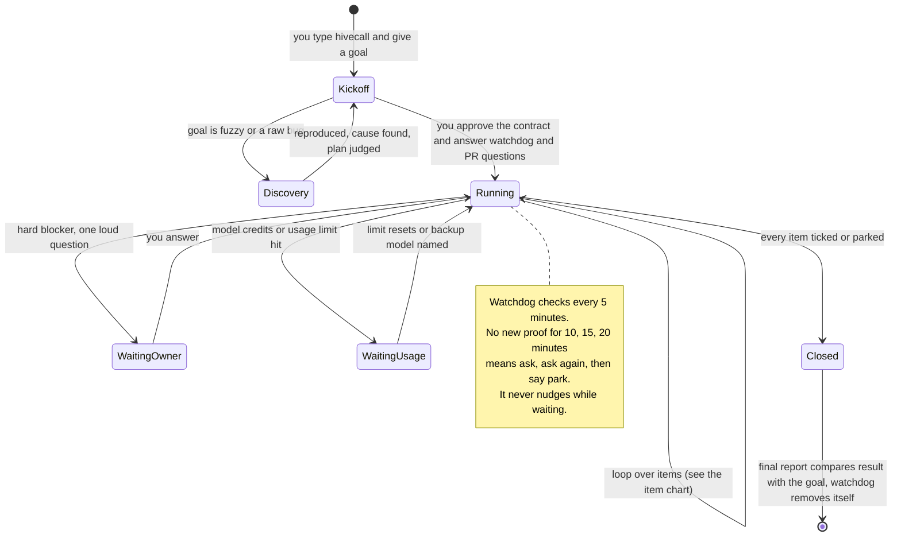
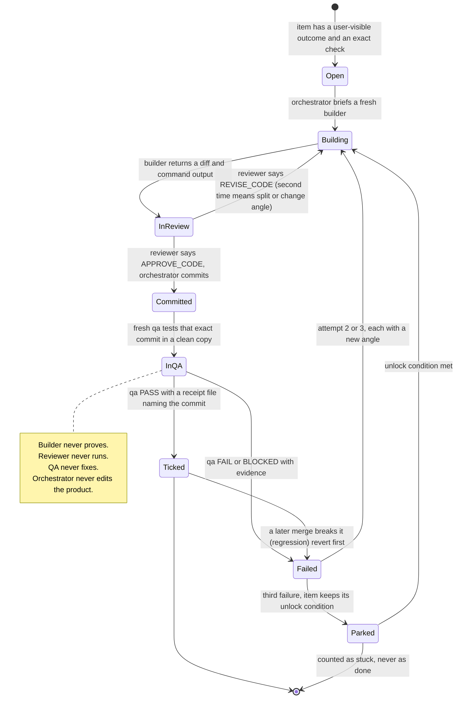

# Hivecall vision

## The system at a glance

**A whole run.** You approve a contract, then leave. The run works the scoreboard until every item is proven or parked, pauses only for you or for a usage limit, and ends with an honest report.



**One checklist item.** Four different agents touch it and none holds two powers. Only the orchestrator ticks, and only on the inspector's receipt.



Why this plugin exists and the rules it must never break, in one file a human can read without opening code. Read it to refresh on what hivecall is for, or when a change feels like it might bend the intent. It should rarely change.

## 1. How the system should work

**Hivecall, in plain English**

You hand it a goal and leave. It must finish honestly, without you, and tell you only what matters.

**How it works**

1. **Start with a contract.** Before any work, the goal becomes a goal contract you approve: current state, ideal state, what must keep working, scope, the check that proves each item, one end-to-end smoke, and exit criteria. Fuzzy input first goes through a short discovery route (reproduce → cause → plan).
2. **Write the scoreboard.** Turn the contract into a checklist. Each item says what the user will see and the exact check that proves it.
3. **The foreman plans but never builds.** The orchestrator picks the next cheapest item that raises the score, briefs a fresh worker, and records results. It never edits the product.
4. **Workers build, judges judge, inspectors prove.** A builder changes code. A reviewer says the diff is sound. QA proves the user outcome on a named commit. No one does two of these.
5. **The score moves only on proof.** An item is ticked only when QA passed it on the exact candidate, with a receipt file. Green tests, a builder saying "done", or a summary never count.
6. **One item, one commit.** Reviewer approves → commit → QA tests that commit → tick. Every proven item is a checkpoint you can return to.
7. **Fail three times, change the angle or park.** Never a fourth try of the same idea. A parked item carries its unlock condition.
8. **The watchdog keeps asking "what passed since I last checked?"** Every 5 minutes, facts only. If nothing passed for 10, 15, 20 minutes, it nudges, then says park.
9. **You hear only real changes.** One line when an item passes, fails or parks. A 🚦 only for hard blockers. Silence means nothing changed.
10. **It can be resumed cold.** The run card and the scoreboard let a fresh orchestrator pick up after a crash or compaction with your rules intact.
11. **It ends honestly.** When every item is ticked or parked, it compares the result with the original goal, not the tick count. If a parked item blocks the promised outcome, the final report says "goal not met" and names the unlock. Closed means stopped, not succeeded.

**The one rule under all of it**

Nobody holds two powers. The maker can't judge, the judge can't prove, the prover can't fix, the foreman can't build, the clock can't act.

**To check any change preserves intent, ask:** Can a builder still certify its own work? Can the score move without a fresh independent receipt? Can a failure be retried the same way a fourth time? If any answer is yes, the change broke it.

## 2. Invariants

Mirrors of the two places the agents and the watchdog actually read. Those files are the source of truth; this section exists so a human sees both sets together. **Sync rule:** whoever edits an invariant in `HOW-TO-WORK.md` or `watchdog/watch.py` updates the matching subsection here in the same commit. Each source file carries a reminder.

### 2.1 Run invariants (`HOW-TO-WORK.md`, section "Invariants")

### Honest

1. Correct beats fast beats cheap. Never fake progress or evidence.
2. The score is ledger items proven by independent evidence on the exact build. Activity is not progress. Planless discovery ticks need fresh qa `REPRODUCED` for a reproduction/cause or fresh reviewer `SELECTED` on a cited non-bug finding (judge-proposal even for one option); cited research alone never ticks. The judge stays apart: qa tests one named commit in its own clean copy (`qa-commit`, `qa-dirty` warns), and a commit that edits an item's own check needs a `CANARY:` receipt line showing a known-broken case still fails (`tick-gate`). A commit that only moves or renames files, or changes tests or docs, on top of proven work ticks on a qa PASS that names that commit; a later failure on the item cancels it.
3. The specs decide (ledger, design docs, prototype, named screenshots). Small visual differences are fine. Record each decision and its reason in the run card.

### Owner

4. Only hard blockers reach the owner, as one loud `🚦` line: disk full after allowed cleanup, model credits out with no backup, push or any remote action, a delete outside the allowlist, a contradiction inside the spec.
5. One status line per real change: an item passes, fails or parks. Silence means nothing changed.
6. Confirm each owner steer in one line once it is applied.

### Progress

7. Hill climb as directly as possible: each step is the cheapest move that raises the proven-item count; stop polishing a tool or check once it can judge the next item. Work off deltas: reuse every valid result and pass each fresh helper only what changed; never re-check a pass whose files did not change (`no-redo` pauses it until a `WHY:` line). Every free item has an agent on it within available capacity; pending launches already count as assigned. Never busywork.
8. Cheapest proof first: test a built fix → fix a known cause → debug an unknown cause → park.
9. A merge that breaks a passed item is reverted first and fixed on the side, unless the cause is known and the repair is one small change (log why).
10. Reflect, then adapt: after three failed attempts on an item (or five run-wide with no new tick), the next brief on it carries `RE-PLAN item=<id|run>` with `Tried:`, `Evidence:` (an existing file) and `Next:` a new angle, a split or park with an unlock condition (`replan` pauses until it does). Never repeat the same idea, widen scope or lower the bar. For a negative find-out result, instead use the one fresh changed-angle retry and park/question rule in SKILL.md; negative evidence never proves absence.

### Debugging

11. Prove the cause with logs before changing code. Never patch a dependency on a theory.
12. Tight, time-boxed loops; extend only while each loop teaches something new.

### Machine

13. Protect the machine: stay within the run's device, build and disk limits. Know the platform and environment you work in (iOS, web, other) and clean up what your work starts: simulators, emulators, browsers, dev servers, recorders, log streams.
14. Delete only from the allowlist: build output, build artifacts and saved app or bundle copies, merged worktrees inside the repo.

### Agents

15. Every running agent is visible in BB, briefed with a `PROMISE:` line and the full TALK-BACK block. Never resume a finished helper; continue its work in a fresh visible child with a Delta.
16. Talk back early through `bb thread tell`: confused, the brief is ambiguous, stuck for 5 minutes, or about to guess means a `QUESTION` to the orchestrator. Ask, then keep doing the parts that don't depend on the answer.
17. A talk-back line names the build it is about; a line about an older build is history.
18. Stop a helper's BB thread as soon as its result arrives.
19. One task, one checkable result, named in the brief (for example "baseline scores saved" or "batch 3 answered"). Group code tasks by the feature they change; no two live tasks touch the same files.
20. Use only the dedicated agents from the system prompt's agent table; never pick a raw model or provider. Their model roles are tuned for price, intelligence and speed.
21. Judges (`reviewer`, or `plan` when judging) only read and return a verdict; workers (`build`, `general`) write; `qa` proves.


### 2.2 Watchdog invariants (`watchdog/watch.py`, header comment)

```
# INVARIANTS — what this script is and is not. Change these only with the user's OK.
# Mirrored in ../VISION.md §2.2 for human reading; update both in the same commit.
#
# 1. Watch, never act on the run. It never stops agents, fixes code, records
#    results or edits the ISA. It pauses its own automation when done and
#    deletes it on the check after the run card closes.
#    (Other exception: at most one OpenCode reload per hour when the server is down.)
# 2. No AI, cheap, every 5 minutes. A plain script that finishes in seconds
#    and adds no load of its own.
# 3. Quiet unless it matters. One status line per run. A message only for a
#    real problem, seen on two runs in a row, sent once per problem. Each
#    run-moving alert is a fact, two questions and a default move, with an
#    alert id the orchestrator answers in the run card. Urgent alerts
#    interrupt the turn (at most once per 10 minutes); the rest are queued.
# 4. Judge agents only against their own promise. "Off track" means no real
#    progress on the work the agent's brief promised, past its pace.
#    Never guess from activity, tone or file names.
# 5. Real progress means proof. Testers: a new PASS/FAIL with evidence.
#    Builders: a growing build log or edits in their own lane. Placeholders
#    and "waiting" don't count.
# 6. Fewer false alarms beats more checks. When an alarm is wrong, remove or
#    loosen the check. Never add a special case.
# 7. Never alarm on missing data. If a read fails (BB, OpenCode, files), skip
#    that check for this run.
# 8. Every agent must be visible in BB. An agent running but not shown is
#    always reported.
# 9. Protect the machine. Report high load, low disk, huge files and orphaned
#    recorders or log processes.
# 10. Keep the run climbing, without spinning. Progress means honest proof: a
#     new PASS/FAIL ledger verdict, a new PASS/FAIL result row with evidence,
#     or a new commit. Revise verdicts, BLOCKED and waiting don't count. With
#     no progress it asks at 10 minutes, asks again at 15 if nothing was done,
#     and says park at 20, even while the orchestrator is busy. Then it stops
#     nudging until progress and leaves the user a note. An idle orchestrator
#     with work left is nudged; 3 idle checks with no change stop that too.
# 11. Stop when done. When the ledger is complete or only parked items remain,
#     pause its own automation; when the run card says closed, pause first and
#     delete the automation on the check after a successful pause.
#     While the run card says waiting, never nudge; keep the other checks.
# 12. Re-anchor after compaction. When the orchestrator compacts its context,
#     send one short message: goal, done and open items, live helpers, stuck
#     items, the owner's rules word for word, and where to re-read the rest.
# 13. Keep the orchestrator itself. When its session's latest turn runs as a
#     different agent than the one it started as, alert it and leave the user
#     a note. Only the user can switch it back.

```
